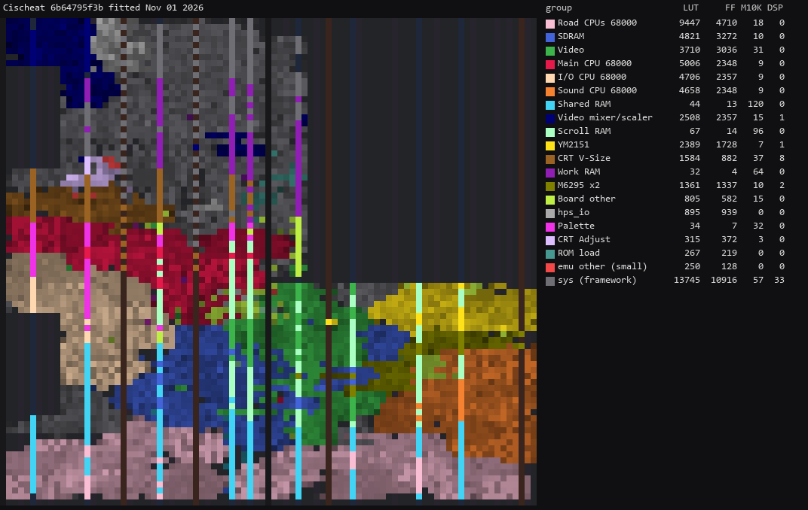

# Cischeat core for MiSTer

A MiSTer FPGA core for Jaleco's Cisco Heat driving-game hardware and its relatives (MAME's
`jaleco/cischeat.cpp`), built with Quartus Prime 17.0.2 Lite for the DE10-nano.

## Contents

- [History](#history)
- [Games](#games)
  - [Supported](#supported)
  - [Not yet](#not-yet)
  - [Out of scope for now](#out-of-scope-for-now)
- [Hardware](#hardware)
  - [Video timing](#video-timing)
  - [Floorplan](#floorplan)
- [Installation](#installation)
- [Controls](#controls)
- [Status](#status)
  - [Todo](#todo)
  - [Resource usage](#resource-usage)
- [AI Attestation](#ai-attestation)
- [Verification](#verification)
- [Acknowledgements](#acknowledgements)
- [Layout](#layout)
- [License](#license)

## History

**20261101**
* First release
* Based on MAME, but the sprite zooming uses a single accululator across tiles to avoid seams and be more like the hw presumably works
* No gear indicator for the supported games - it toggles lo/hi like Outrun in all three
* Wild Pilot left out as I want to fix it in MAME and here

## Games

### Supported

| Name | Set | Year | Board | Notes |
|-|-|-|-|-|
| Big Run (11th Rallye version, Europe) | `bigrun` | 1989 | Big Run | Attract and sound on hardware |
| Cisco Heat | `cischeat` | 1990 | Cisco Heat | Boots and races on hardware |
| Grand Prix Star (ver 4.0) | `f1gpstar` | 1992 | F1 GP Star | Attract and sound on hardware |
| Grand Prix Star (ver 3.0) | `f1gpstar3` | 1991 | F1 GP Star | Clone; attract on hardware |
| Grand Prix Star (ver 2.0) | `f1gpstar2` | 1991 | F1 GP Star | Clone; attract on hardware |
| Big Run (11th Rallye version, US) | `bigrunu` | 1989 | Big Run | Clone; attract on hardware |
| F-1 Grand Prix Star II | `f1gpstr2` | 1993 | F1 GP Star + I/O CPU | Attract on hardware |

### Not yet

| Name | Why |
|-|-|
| Wild Pilot (`wildplt`) | Its `.mra` is in `releases/unsupported/`. Stock MAME 0.289 marks it `MACHINE_NOT_WORKING`; the core follows a patched MAME (`docs/ROADMAP.md`, Verification strategy). Boots and runs attract on hardware |

## Hardware

| Chip | Function | Status |
|-|-|-|
| 68000 x4-5 | main, two road CPUs, sound, I/O (f1gpstr2, wildplt) | FX68K, vendored unchanged; main CPU boot traced against MAME |
| Mega System 1 tilemaps x3 | 8x8/16x16 page-mapped scroll layers | written here from `ms1_tmap.cpp` |
| Jaleco road x2 | per-line road layers; zooming on F1 GP Star and Wild Pilot | written here from `jaleco_road.cpp` |
| Jaleco zoom sprites | zooming sprite generator, two record formats | written here from `jaleco_zoomspr.cpp`; one zoom accumulator per sprite, not MAME's per-tile scaling (`docs/HACKS.md`) |
| D65006 / GS88000 gate arrays | sound-program bitswap and unlock handshake (Big Run, Cisco Heat) | bitswap applied at load time |
| YM2151 | FM | jt51, vendored unchanged |
| M6295 x2 | ADPCM samples from SDRAM | jt6295, vendored unchanged |

### Video timing

6.000 MHz pixel clock (48 MHz / 8), 384 x 260 total, 15.625 kHz and 60.096 Hz; 256 x 224 visible
(Cisco Heat's MAME visible area is 216 lines). MAME declares only 60 Hz and a 256 x 256 screen, so
the pixel clock is a hypothesis (`docs/ROADMAP.md`, Open items). Display aspect is 4:3.

### Floorplan

`Cischeat` revision at `6b64795`, fitted 2026-11-01; per-block counts in
`docs/floorplan/Cischeat_groups.md`.

## Installation

A 32 MB SDRAM module is required.

* Take the latest `*.rbf` from `releases/` and put it in `_Arcade/cores`, renamed to drop the
  `Arcade-` prefix (`Arcade-Cischeat_YYYYMMDD.rbf` becomes `Cischeat_YYYYMMDD.rbf`). MiSTer launches
  the highest-sorting match for `<rbf>Cischeat</rbf>`, and a `Cischeat_*.rbf` sorts above every
  `Arcade-Cischeat_*.rbf`
* Take the `*.mra` files and the `_alternatives` folder from `releases/` and put them in `_Arcade`
  (or a subdirectory starting with an underscore, e.g. `_Arcade/_Cischeat`)
* Put the MAME merged or split ROM sets in `games/mame`

To run a development build instead: `python scripts/build_staged.py`, then `python scripts/deploy.py`
with a `mister.env` (see `scripts/deploy.py`).

## Controls

Driving games: Brake, Gear Shift (toggles low/high, as MAME's `PORT_TOGGLE`), Accelerator, Horn
(Big Run and Cisco Heat), Start, Coin, Pause, Service. The wheel is the left stick's X axis or the
d-pad (`docs/HACKS.md`); on Big Run the accelerator is also the left stick pushed up.

Wild Pilot: Shot, Missile, Bomb, Start, Coin, Pause, Service, with the stick as the yoke.

Keyboard, MAME's defaults: arrows, LCtrl LAlt Space LShift, Start 1, Coin 5; F2 service switch,
P pause.

## Status

Known issues:

* Cabinet link between machines
* Sprite zoom differs from MAME by a few thousand pixels a frame on zoomed sprites (one
  accumulator per sprite).
* Wild Pilot's road shared-RAM order differs from the other boards, from a patched MAME rather
  than stock (`docs/HACKS.md`).
* Hiscore saving is not wired up.

`docs/MAME_KLUDGES.md` lists what is taken from MAME as behaviour and what is known not to be
right. `docs/HACKS.md` lists this core's own approximations. `docs/ROADMAP.md` is the plan and its
progress; `docs/LESSONS_LEARNED.md` is what it cost.

### Todo

- [ ] Cabinet link between machines
- [ ] Hiscore
- [ ] Wild Pilot out of `unsupported`

### Resource usage

Release revision `Cischeat` at `6b64795` on the DE10-nano's Cyclone V 5CSEBA6, speed grade 7,
timing met (worst setup slack 0.346 ns):

| resource | used | available |
| --- | --- | --- |
| Logic (ALMs) | 31,917 | 41,910 |
| Block memory bits | 3,845,785 | 5,662,720 |
| RAM blocks | 542 | 553 |
| DSP blocks | 45 | 112 |
| PLLs | 3 | 6 |

RAM blocks are the one to watch: 11 are free.

## AI Attestation

This core is being developed with heavy use of a frontier coding assistant.

## Verification

Not PCB-validated, other than youtube videos. MAME is the accuracy reference, with its own acknowledged uncertainties noted
where they matter.

* Cisco Heat main CPU boot: 700,000 bus accesses against MAME, all matching
  (`sim/cischeat_boot_tb`, `docs/PHASE0.md`).
* Video engines: Cisco Heat's model frame reproduced on four captures, 0 mismatches
  (`docs/PHASE1.md`).
* ROM load: Cisco Heat's SDRAM image after DDR3, loader and transforms equals MAME's initialised
  regions, 7,864,320 words (`sim/rom_load_tb`).
* Sprite line budget on hardware: 0 cut lines in 23,958 frames of f1gpstar attract (ISSP F).

## Acknowledgements

- **Sorgelig** and the **MiSTer-devel team** for the
  [Template_MiSTer](https://github.com/MiSTer-devel/Template_MiSTer) framework and the SDRAM
  controller.
- The **MAMEdev team**: Luca Elia for `cischeat.cpp`, `ms1_tmap`, `jaleco_road` and
  `jaleco_zoomspr`; Angelo Salese and David Haywood for `ms1_gatearray`. They are this core's
  specification.
- **Jorge Cwik** for [FX68K](https://github.com/ijor/fx68k).
- **Jose Tejada Gomez** for [jt51](https://github.com/jotego/jt51),
  [jt6295](https://github.com/jotego/jt6295) and `jtframe_dual_ram16`.
- **rmonic79** for CRT Adjust; **JimmyStones** for
  [Hiscores_MiSTer](https://github.com/JimmyStones/Hiscores_MiSTer).

`THIRD-PARTY.md` has the full list and licences.

## Layout

Standard [Template_MiSTer](https://github.com/MiSTer-devel/Template_MiSTer) structure:

| path | contents |
| - | - |
| `sys` | MiSTer framework, vendored from the template, never edited |
| `rtl` | core source; vendored modules carry a `PROVENANCE.md` |
| `releases` | `.rbf` and `.mra` files; clones in `_alternatives`, Wild Pilot in `unsupported` |
| `docs` | roadmap, workflow, release process, kludges, hacks, lessons |
| `sim` | ModelSim and Verilator testbenches |
| `scripts` | build, deploy, capture and verification tooling |
| `debug` | reference captures from MAME used as ground truth (gitignored) |
| `roms` | your own MAME sets (gitignored, never committed) |

## License

GPL-3.0-or-later (see `LICENSE`). Imported components keep their own licences; `THIRD-PARTY.md`
has the detail and every modified vendored file states the change in its header.

Game ROMs contain copyrighted material and are not included. Obtaining them is your
responsibility.
